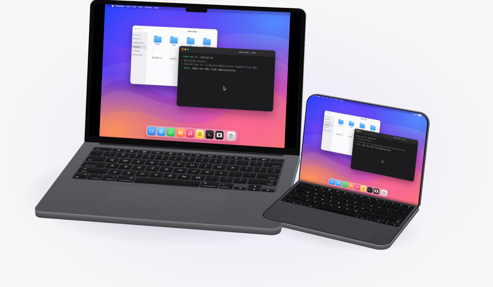
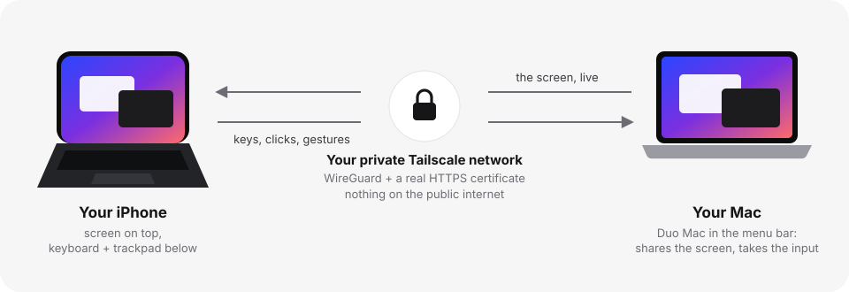
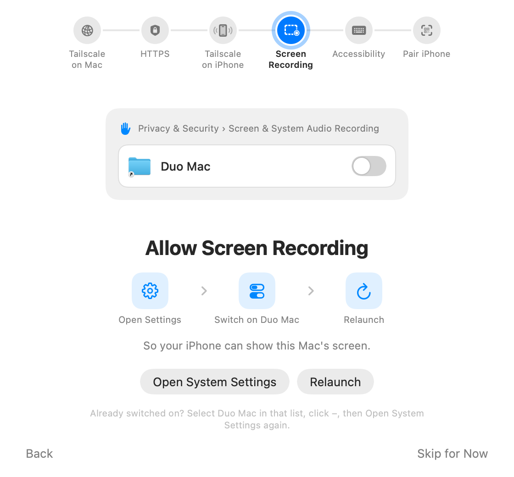
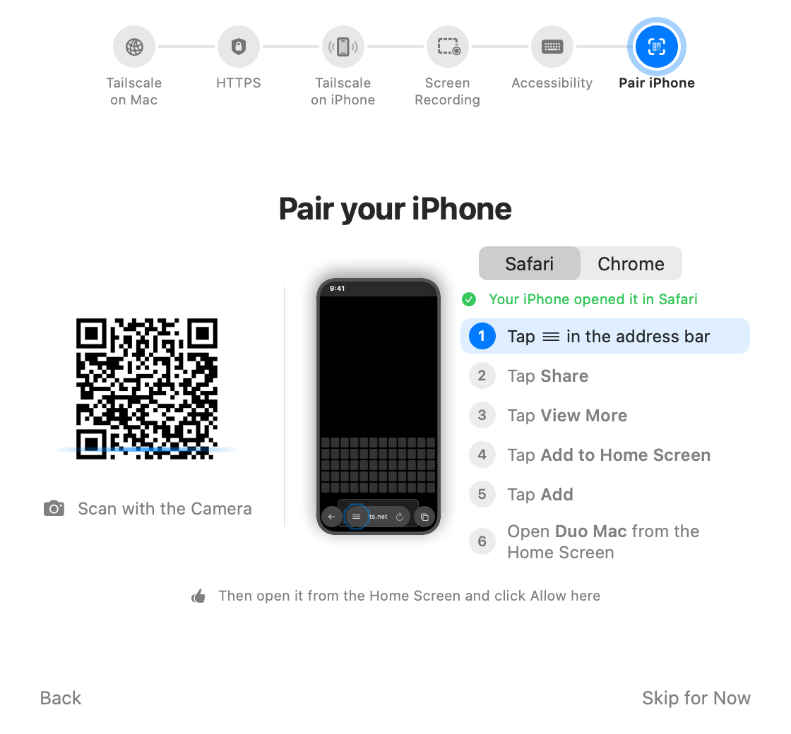
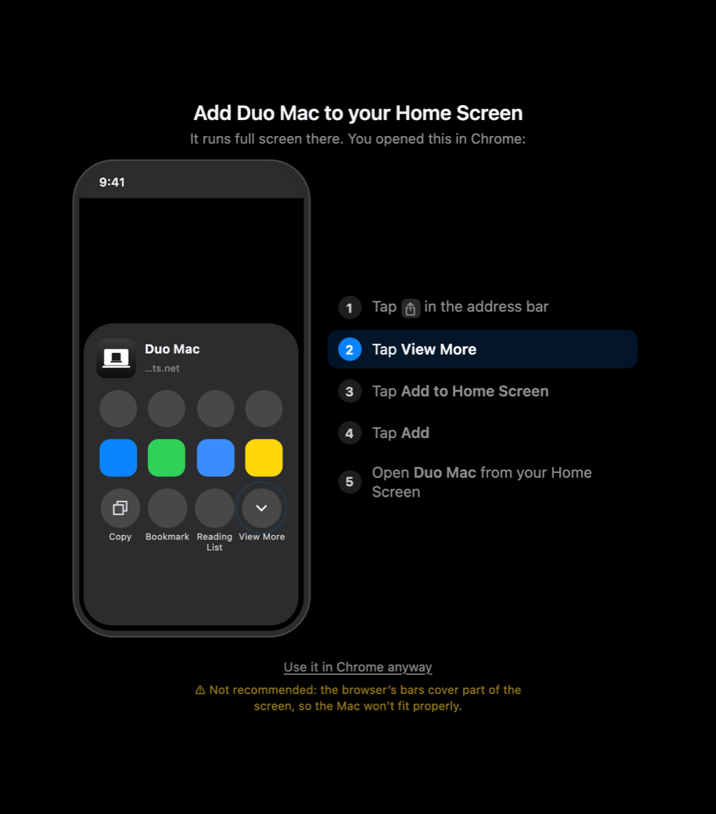
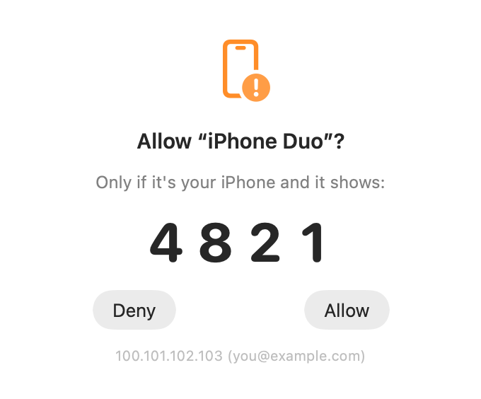
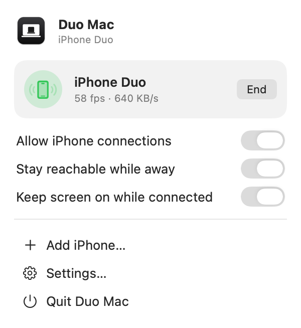
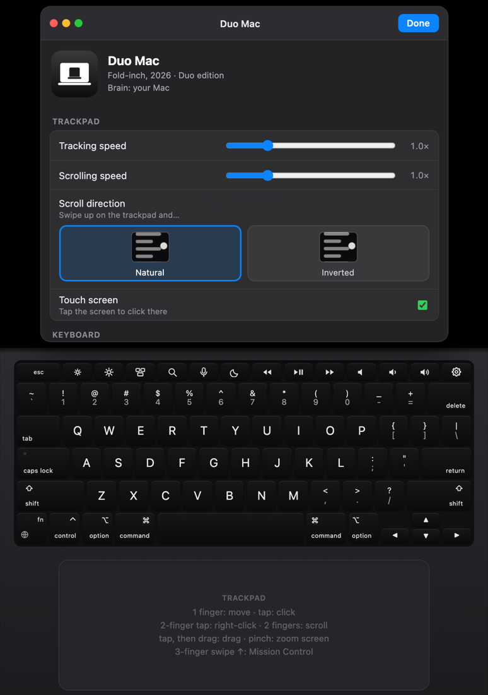

<p align="center"></p>

<h1 align="center">Duo Mac</h1>

<p align="center"><b>Your Mac, on your iPhone Duo.</b><br>
Free and open source. Fold your iPhone like a laptop: your Mac's screen on top, a keyboard and trackpad below.</p>

<p align="center">
  <a href="https://duo-mac.vercel.app">Website</a> ·
  <a href="#install">Install</a> ·
  <a href="https://duo-mac.vercel.app/#film">Watch the intro</a> ·
  <a href="LICENSE">MIT License</a>
</p>

<p align="center"></p>

**Give this to your agent** (Claude Code, Codex, Cursor…) and it installs Duo Mac for you:

```
set up Duo Mac on this Mac: https://duo-mac.vercel.app/llms.txt
```

## What it does

- **Mirrors and controls your actual Mac.** Your apps, files and windows, live. Not a copy, not a cloud computer. Every key, click and swipe goes straight to the Mac. The Mac even gets an extra display shaped exactly like the Duo's top half, so it fills the screen edge to edge.
- **Feels like a MacBook.** A full keyboard with the function row and ⌘ shortcuts, labelled with your Mac's own layout, and a trackpad with click, right-click, scroll, drag, pinch and Mission Control. Key sounds and haptics included.
- **Private, end to end.** Your iPhone reaches the Mac through your own [Tailscale](https://tailscale.com) network: WireGuard encryption plus a real HTTPS certificate. Nothing is ever on the public internet.
- **Unlocked with a passkey.** Each iPhone is paired once and approved on the Mac with a matching code. After that it opens with your passkey.
- **Yours to tune.** Text size, quality, scroll direction, where the screen ends and the keyboard begins, sounds, haptics. All with visual settings on the iPhone.
- **Anywhere.** Café, train, bed: as long as your Mac is awake and online, your iPhone reaches it.
- **Works on any iPhone.** It's made for the iPhone Duo's fold. On any other iPhone the screen, keyboard and trackpad are stacked on one screen. It works just as well. It's just not as cool.

## How it works

<p align="center"></p>

A small menu bar app on the Mac captures the screen and sends only the parts that change (typing costs a kilobyte or two). The iPhone side is a web app the Mac serves itself, added to the Home Screen so it runs full screen. They talk over one encrypted WebSocket inside your Tailscale network. No account, no server in between.

## Install

You need:

- A Mac with Apple silicon on **macOS 14** or later, with the Xcode Command Line Tools (`xcode-select --install`).
- **Tailscale** (free for personal use) on the Mac and on the iPhone, signed in to the same account. On the iPhone, allow the VPN configuration and turn on *VPN On Demand* so it stays connected.

### 1. Build it

```bash
git clone https://github.com/craiker/duo-mac.git
cd duo-mac && ./build.sh
```

This builds the helper (a minute or two) and puts **Duo Mac** in your Applications folder.

### 2. Follow the setup guide

Open **Duo Mac** from Applications or Spotlight. A visual guide walks through each step and ticks it off by itself: Tailscale, HTTPS, Screen Recording, Accessibility and pairing. For Screen Recording, switch on Duo Mac in System Settings, then click **Relaunch**.

<p align="center"></p>

### 3. Pair your iPhone

1. Scan the QR code with the iPhone's Camera.
2. Add the page to your Home Screen. The page detects your browser and shows the exact taps for Safari or Chrome, and so does the Mac.
3. Open **Duo Mac** from the Home Screen and tap **Pair this iPhone**.
4. On the Mac, check the 4-digit code matches and click **Allow**.
5. On the iPhone, set up your passkey (and a backup PIN if you like).

<p align="center">
  
  
</p>
<p align="center"></p>

Half-fold the Duo like a laptop. If it rotates the wrong way, lock rotation in Control Center. macOS may ask once a month whether Duo Mac may keep recording the screen; say Allow.

## Using it



Duo Mac lives in the **menu bar**. Its panel shows the connected iPhone and the main switches; *Settings…* opens General, Add iPhone, Paired iPhones and Setup.

**Trackpad** (the whole area below the keyboard works, not just the drawn pad):

| Gesture | Does |
|---|---|
| 1 finger | move the pointer |
| tap / tap twice / three times | click / double-click / triple-click |
| tap, then touch again and drag | drag (window, selection, file…) |
| 2-finger tap | right-click |
| 2 fingers | scroll, with momentum |
| pinch | zoom the iPhone's screen (it follows the pointer) |
| 3- or 4-finger swipe ↑ / ↓ / ← → | Mission Control / App Exposé / switch Spaces |

**Screen** (top half, or the whole phone in *Screen only*): tap to click exactly there, drag to drag, 2 fingers to scroll (with momentum), pinch to zoom, 2-finger tap to right-click, 3 or 4 fingers to swipe for Mission Control, App Exposé and Spaces. *Screen only* fills the whole phone, edge to edge, and reshapes when you rotate it. In *Screen only*, tapping a text field on the Mac brings up the iPhone's own keyboard, and you can choose to use the whole screen as a trackpad instead (Settings › Display › *Touching the screen*): slide to move the pointer, tap to click, with all the trackpad gestures.



**Keyboard**: labelled with your Mac's actual layout (ANSI or ISO).

- Hold ⌘ and tap C, or tap ⌘ then C (one-shot). Double-tap a modifier to lock it.
- The top row works like a MacBook's: brightness, Mission Control, Spotlight, media, volume. Hold **fn/🌐** for F1–F12, Home/End/Page Up/Page Down and forward delete.
- Long-press **fn/🌐**, or the 🎤 key, to type with the iPhone's own keyboard (dictation, emoji, accents).
- The **⚙︎ key** (top right, where Touch ID sits on a MacBook) opens the settings.
- A Bluetooth keyboard paired with the iPhone types on the Mac too.

**Settings** (⚙︎ key): tracking and scroll speed, natural scrolling, key sounds and haptics, F-key mode, quality (Fast / Balanced / Sharp), Mac screen (Fill with the Duo display, or Mirror as is), desktop size, layout (Laptop: keyboard and trackpad; Trackpad: just a big trackpad; Screen only, touched directly or as a trackpad), touch screen, Space Black or Silver (Laptop), fold position, top edge (start below the clock, or Full screen), notch, stats.

**Duo display** (on by default): instead of squeezing your 16:10 screen into the phone's half, the Mac gets an extra display shaped exactly like it, and the Mac's own screen mirrors it. *Desktop size* picks how roomy it is: Larger text, Default or More space. It goes away a minute after the iPhone disconnects (or right away with *Mirror as is*, or when you quit the app).

**Fold to close** (iPhone Duo): folding the phone turns its screen into a closed MacBook lid, edge to edge, and hangs up, so the Mac stops sharing its screen and can sleep; unfolding picks up where you left off. To use Duo Mac folded, turn off Settings › Display › *Folding closes the lid*.

**iPhone microphone** (optional): Mac apps (dictation, calls, voice modes) can hear the iPhone instead of the Mac. Add the **Duo Mac Microphone** once on the Mac (menu bar › Settings… › General › Install…, asks for your password; sound pauses for a second while Core Audio restarts), then turn on *Use this iPhone's microphone* in the iPhone settings (it tells you if the Mac doesn't have the driver yet). While it's on, the Duo Mac Microphone is the Mac's default input; your usual microphone comes back when it's off or the iPhone disconnects. It's a small loopback audio driver (`driver/`): Duo Mac plays the phone's audio into a hidden *Feed* device, and it comes back out of the microphone.

**Away from home**: the Mac must be awake. Turn on **Stay reachable while away** in the menu bar panel and keep it plugged in; a closed MacBook still sleeps unless an external display is connected.

<br clear="right">

## Security

- **Not on the internet.** The helper listens on the Mac only (127.0.0.1). Tailscale Serve publishes it at `https://<mac>.<tailnet>.ts.net`, reachable only by devices signed in to your Tailscale account, end-to-end encrypted, with a real HTTPS certificate.
- **Only paired iPhones.** The QR code's pairing code only lets a phone *ask*; someone at the Mac must click **Allow** after comparing the 4-digit code. Each phone gets its own random key (the Mac stores only a hash). Remove a phone in Settings → Paired iPhones and it's cut off at once.
- **A passkey every time you open it** (bound to the Mac's address), or the PIN. Five wrong PINs pause the PIN for an hour (doubling after that). Reconnecting within 15 minutes (folding, network changes) doesn't ask again; *Lock* in the settings does.
- **On the Mac:** a banner and sound when an iPhone takes control, a menu bar icon (green while connected) with *End*, an **Allow iPhone connections** switch, disconnect after 30 minutes without use, and a log in `~/Library/Logs/Duo Mac/connections.log`.
- **Optional Tailscale hardening:** turn on *Device approval* in the admin console and two-factor sign-in on your Tailscale account; whoever controls that account controls your tailnet.

## Troubleshooting

| Problem | Fix |
|---|---|
| iPhone can't open the link | Is Tailscale connected on the iPhone (VPN icon), signed in to the same account as the Mac? Is Duo Mac running, with a QR code showing? |
| The switch is on in System Settings but the guide still asks | macOS kept an entry for an older build. Select Duo Mac in that list, click –, then click *Open System Settings* in the guide again. |
| "Can't unlock here" / no passkey prompt | The passkey is tied to the Mac's address it was set up for. Use the PIN, or Unpair in the settings and pair again. |
| "One more step on the Mac" / black screen | Screen Recording isn't on yet. After switching it on, Duo Mac must relaunch. |
| Keyboard and trackpad do nothing | Accessibility isn't on yet. |
| Scrolling goes the wrong way / pointer too slow | *Natural scrolling* and *Tracking speed* in the settings. |
| Laggy | Quality → *Fast*, or move closer to the router. Stats (frame rate, latency) can be shown in the settings. |
| "That pairing code is out of date" | Someone made a new pairing code on the Mac: scan the new QR code. Paired iPhones aren't affected. |
| Screen freezes / "Reconnecting…" | The phone notices a dead connection within ~6 s and reconnects by itself. Folding the phone shut hangs up on purpose; unfolding reconnects. |
| The Mac's screen has black bars | That's the Duo display at work. It goes back to normal a minute after the iPhone disconnects, or pick *Mirror as is*. |
| Anything else | `~/Library/Logs/Duo Mac/helper.log` (iPhone-side errors are recorded there too). |

## How it's built

- **Mac helper** (`helper/`, Swift, no dependencies): a small HTTP and WebSocket server (Network.framework), ScreenCaptureKit capture, 32-px tile diffing so only changed areas are sent as JPEGs, ack-based flow control so a slow network skips stale frames instead of lagging, and changed areas re-sent sharper once the screen is still. Input arrives as small JSON messages and is posted with `CGEvent`. The menu bar app, settings window and setup guide are SwiftUI.
- **Duo display** (`NanoDisplay.swift`): a `CGVirtualDisplay` (the private CoreGraphics API DeskPad and BetterDisplay use) at Retina resolution, mirrored by the main display. All changes are made for this app only, so they revert if it quits.
- **Launcher** (`launcher/`): `Duo Mac.app` is a tiny stub that starts the helper from `~/Library/Application Support/Duo Mac/`. macOS ties permissions to an app's signature, and without a developer certificate every rebuild would lose them. With the stub, the helper can be rebuilt freely and permissions stay.
- **iPhone app** (`web/`, plain JavaScript modules): canvas renderer, MacBook keyboard (ANSI/ISO, labels from the Mac's layout), gesture recognizer, WebAudio key sounds, visual settings, and the Add to Home Screen guide. Served by the helper; nothing is hosted online.
- **Security** (`Auth.swift`, `Tailscale.swift`): WebAuthn (ES256) verified on the Mac with CryptoKit; PINs stored as PBKDF2-SHA256 hashes; `devices.json` and `config.json` readable only by you. The helper runs `tailscale serve` itself and turns it off when it quits.
- **Website** (`site/`): the page at [duo-mac.vercel.app](https://duo-mac.vercel.app), static HTML, CSS and JavaScript. The 3D MacBook and iPhone Duo are plain CSS 3D transforms.

## Development

```bash
./build.sh                 # build the helper and install it (keeps permissions)
./build.sh --app           # also rebuild Duo Mac.app (permissions must be granted again)
```

`build.sh` installs the helper and a copy of `web/` into `~/Library/Application Support/Duo Mac/`, outside `~/Documents` on purpose: macOS would otherwise stop the helper to ask for Documents access. Re-run it after editing `web/`, then reload the page.

Test without sharing the real screen or touching real input (synthetic test screen, input only logged, plain http on localhost, pairing approved automatically):

```bash
"build/Duo Mac" --headless --test-pattern --port 8891 --auto-approve --config-dir /tmp/duo-test
```

Then open the printed URL and pair with a PIN. `"build/Duo Mac" --selftest-auth` checks the passkey and PIN code. `swift tools/webcheck.swift <url> 430 900 8 out.png` loads the app in WebKit and saves a snapshot. Run from `build/` like this, the helper serves `web/` live from the project folder.

**Icon:** `design/icon.svg` → `rsvg-convert -w 1024 design/icon.svg -o design/icon.png`, then `swift tools/make-icons.swift . && ./build.sh --app`. Earlier icons are kept in `design/old-icon-duo-laptop/` and `design/old-icon-laptop/`.

**Website:** `site/` deploys as a static site (`vercel deploy site`). Add `#shot` to the URL for a still frame of the hero, `#og` for the social card.

Ideas for later: H.264 video through WebCodecs (sharper, much less data on mobile networks), and using the fold angle once Apple exposes it to web apps.

## License

[MIT](LICENSE). Duo Mac is not affiliated with Apple. Mac and iPhone are trademarks of Apple Inc.
